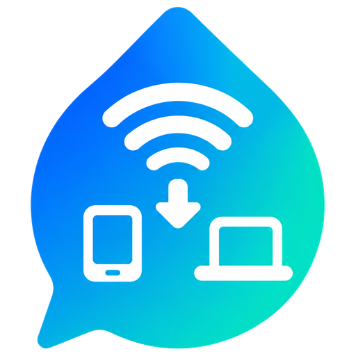

<div align="center">



# DropMate

**Chat and send files to the people in your home, over your own Wi-Fi. No internet, no cloud, no account.**

[](https://github.com/iamshihab2020/DropMate/releases/latest)
[](LICENSE)


**[Website](https://iamshihab2020.github.io/DropMate/)** · **[Download](https://github.com/iamshihab2020/DropMate/releases/latest)**

</div>

DropMate is a messenger that only works on your own Wi-Fi. Pair with someone once, then chat with them and send them anything: a 4 GB movie, a folder of photos, an app, a document. Files go straight from one device to the other at Wi-Fi speed. Nothing is uploaded anywhere, and there is no account to create.

It knows people, not just devices. Your laptop and your phones are all "you", so a message or a file sent to you reaches whichever of your devices is around, and your history follows you from one to the other.

## Download and start

**Windows 10 or 11**

1. Download **DropMate-1.1.0-windows-setup.exe** from the [latest release](https://github.com/iamshihab2020/DropMate/releases/latest) and run it.
2. Windows may warn that the app is from an unknown publisher, because the installer is not signed yet: choose **More info**, then **Run anyway**.
3. The installer lets DropMate through the Windows firewall for your local network only.

**Android 8 or newer**

1. On the phone, download **DropMate-1.1.0-android.apk** from the [latest release](https://github.com/iamshihab2020/DropMate/releases/latest) and open it.
2. Allow your browser or file manager to install apps when Android asks, then tap **Install**.
3. If the phone says the app isn't compatible, it's an older 32-bit phone: use **DropMate-1.1.0-android-older-phones.apk** instead.
4. Allow notifications, and allow DropMate to run in the background, so files arrive with the app closed.

**Pair once**

1. Both devices on the same Wi-Fi. On one, tap **Add**, then **Show my code**.
2. On the other, scan the QR code or type the code.
3. Both screens show four emojis. If they match, tap **Confirm** on both. You never have to pair again.

To add your own second device (another phone, or your laptop), choose **Link my device** instead. It joins as you, with your chats and contacts.

## What it can do

- **Chat, one conversation per person:** messages, files and photos in one timeline, with Waiting, Received and Seen ticks.
- **Send anything, any size:** files, whole folders, or photos and videos from the phone's gallery. On Windows, drag files onto a chat or onto a person's name, paste them with Ctrl+V, or right-click a file in Explorer and choose **Send with DropMate**. On Android, share from any app to DropMate.
- **Photos show as pictures:** tap one to open a full-screen viewer, then swipe (or use the arrow keys on the PC) through every photo and video in that chat.
- **Fast and safe transfers:** files move in 4 MB chunks, several at a time, and every chunk is checked. A transfer that stops picks up where it left off. Finished transfers show how fast they went, for example "1.2 GB in 38 s · 32 MB/s".
- **You approve what arrives:** a request pops up with Accept and Decline. If you and a person both agree, files from them up to a size you choose arrive without asking. Apps and scripts always ask.
- **Your own devices work together:** send between your laptop and phone without approving anything. Your chats, contacts and settings sync between them, and a file received on your laptop can be fetched to your phone.
- **Buzz:** ring someone's phone at full volume, even when it's on silent, to call them or to find it. In **My devices**, the same button rings your own phone.
- **Receives in the background:** on Android, files arrive with the app closed or the phone locked. On Windows, DropMate waits in the tray.
- **Any direction:** PC to PC, phone to phone, PC to phone. Phones work with the laptop switched off.
- **English and বাংলা,** light and dark themes, and reduced motion when the system asks for it.

## Private by design

- There is no server. DropMate never connects to the internet, and nothing you send leaves your Wi-Fi.
- You pair once by checking that four emojis match on both screens. After that, each device knows the other's keys and refuses anyone else.
- Every connection is encrypted with TLS to a pinned certificate, and every request is signed with the device's Ed25519 key. Someone else on the same Wi-Fi cannot send you files or read what you send.

## Build from source

You need [Flutter](https://flutter.dev) (stable), the Android SDK, and Visual Studio 2022 with **Desktop development with C++** (including the ATL component).

```sh
flutter pub get
flutter test                      # unit tests and end-to-end tests (three devices over loopback TLS)
flutter run -d windows            # or: flutter run -d <android device>
flutter build apk --release --split-per-abi
flutter build windows --release   # then: iscc installer\dropmate.iss  (Inno Setup 6)
```

Benchmarks are tagged `perf` and skipped by default: `flutter test -t perf --run-skipped`.

| Path | What |
|---|---|
| `lib/core/` | Pure logic: crypto, request signing, rosters, the auto-accept agreement, chunk bitmaps, file name sanitizing, the hashing isolate pool |
| `lib/data/` | SQLite schema and queries |
| `lib/services/` | `engine.dart` (presence, messages, receipts, buzz, rosters, own-device sync), `pairing.dart`, `transfers.dart`, `discovery.dart` (mDNS and UDP multicast), `net.dart` (HTTPS server and pinned client) |
| `lib/platform/` | Notifications, thumbnails, power and Wi-Fi locks, the Android bridge |
| `lib/ui/` | Screens and the design system |
| `android/.../kotlin/` | Long-lived engine, foreground service, boot receiver, pickers, streamed `content://` reads, thumbnails, share target, buzz |
| `installer/` | Inno Setup script |
| `test/` | Unit, end-to-end and benchmark tests |

### How it works

- Each device has an Ed25519 signing key and a self-signed TLS certificate. Clients pin the receiver's certificate, and every request is signed (Dart can't verify self-signed client certificates, so this replaces mutual TLS).
- A person is a signed roster of devices. Pairing exchanges rosters, so every device of both people trusts the others. A new device of yours is added by one already in your roster, and your contacts accept it without pairing again.
- Files move in 4 MiB chunks, each checked with SHA-256, and the whole file is checked against the hash of its chunk-hash list. To resume, the sender asks the receiver which chunks it already has.
- Your own devices sync messages, contacts, nicknames and auto-accept agreements by pulling each other's change log.
- Visual design (colours, type, motion) is described in [docs/DESIGN.md](docs/DESIGN.md).

## Known limits

- Windows and Android only. iPhone, Mac and Linux are not supported yet.
- Some routers, especially guest networks, stop devices from talking to each other ("client isolation"). DropMate tells you when it suspects this.
- Android saves into `Download/DropMate`. Choosing a folder per person works on Windows.
- Buzz and Seen ticks need DropMate 1.1.0 or newer on both devices.

## Contributing

Bug reports and ideas are welcome in [Issues](https://github.com/iamshihab2020/DropMate/issues). Read [CONTRIBUTING.md](CONTRIBUTING.md) before you open a pull request.

## Licence

DropMate is made by [Sheikh Shihab Hossain](https://github.com/iamshihab2020) and released under the [Apache License 2.0](LICENSE).

You may use, change and share it, including in your own products. If you publish DropMate or a version based on it, you must keep the [NOTICE](NOTICE) file crediting the original author and say what you changed. The DropMate name and logo are not part of the licence, so a modified version must use its own name.
